# Elifoot 98 Launcher

Wrapper para rodar o **Elifoot 98** (1998, André Elias e Ricardo Correia) em Windows 10/11 modernos, incluindo o editor de equipes e o registrador CRACK.EXE.

Traz UI para configurar resolução e modo janela/fullscreen, e embute [otvdm](https://github.com/otya128/winevdm) (para os executáveis 16-bit) e uma versão portable do DOSBox (para o `CRACK.EXE` DOS-only).

## Download

Baixe a última versão em **[Releases](https://github.com/juan-silveira/elifoot98-launcher/releases/latest)**:
Windows (`setup .zip`), Linux (`.deb` ou `.AppImage`), macOS (`.zip`) e Android (`.apk`).

## Ferramentas

- **Editor de Equipes** — busca e filtro por país, nota/lesão/comportamento/estrela de cada jogador (o jogo tira do nome), validação com as regras do jogo antes de gravar e cores livres. O editor original continua disponível.
- **Scout** — todos os jogadores do seu save, com filtros, ordenação por várias colunas, Score (0 a 1000), Impacto e histórico de jogos, gols, lesões, amarelos e expulsões ([como o score é calculado](docs/score.md)).
- **Editor de Save** — inflação, dinheiro, moral, estádio, cores, troca de equipe do treinador e atributos dos jogadores, sempre dentro dos limites do jogo.
- **Editor de Árbitros**, **Aplicar Patch** e opção de **estrangeiros** Original (com limites) ou Liberado.
- **Android** — o jogo roda em retrato ou paisagem, com botões na tela, zoom com pinça e táticas indisponíveis em cinza.

## Mudanças no jogo

O launcher traz o `ELIFOOT.EXE` 98.003 com alguns patches, todos documentados:

- **Equipes por divisão** (em Configurações): de 8, o original, até 20.
  - A temporada passa a ter 2 × (N − 1) jornadas.
  - A Classificação e a tela da jornada mostram 2 divisões por página.
  - Com 16 ou mais equipes, sobem e descem 4 por divisão.
  - A inflação por jornada se ajusta, e cada temporada anda o mesmo que no original.
  - Um jogo gravado só continua com o número de equipes em que foi começado. O launcher mostra no jogo só os saves desse número, e o Editor de Save e o Scout indicam o número de cada save.
  - Detalhes em [docs/patch-divisoes.md](docs/patch-divisoes.md).
- **Até 30 jogadores por equipe**: o jogo tinha 24 nas compras e leilões, e 20 no editor.
- **Tática 5-0-5** com a tecla **T** no menu Seleccionar.
- **Cartões amarelos**, que o jogo não tinha (uns 4 por jogo, e o vermelho fica mais raro).
  - O 2º amarelo no mesmo jogo vira vermelho 1 vez em 4; 3 amarelos acumulados dão 1 jogo de suspensão.
  - Aparecem na tela da jornada, nos detalhes da partida (caixinha "Cartões amarelos"), com **A** no plantel, "N amarelos acumulados" na aba Jogador e a linha "Cartões amarelos" no Historial.
  - O Scout mostra os amarelos da carreira e o Editor de Save edita os acumulados.

O que se sabe de como o jogo funciona por dentro está em [docs/elifoot98-interno.md](docs/elifoot98-interno.md).

## Telas

### Linux / Windows / macOS

| Scout | Editor de Equipes |
|---|---|
| 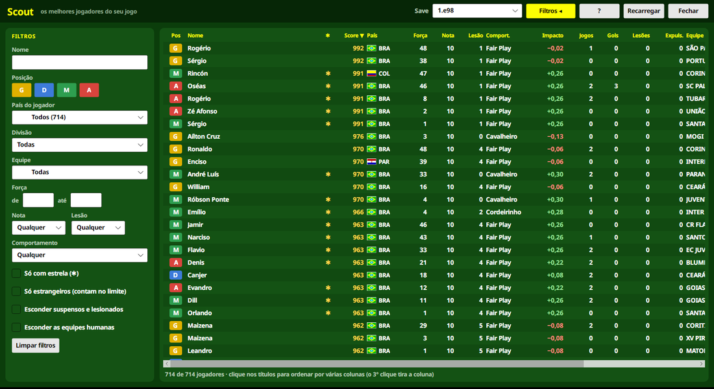 | 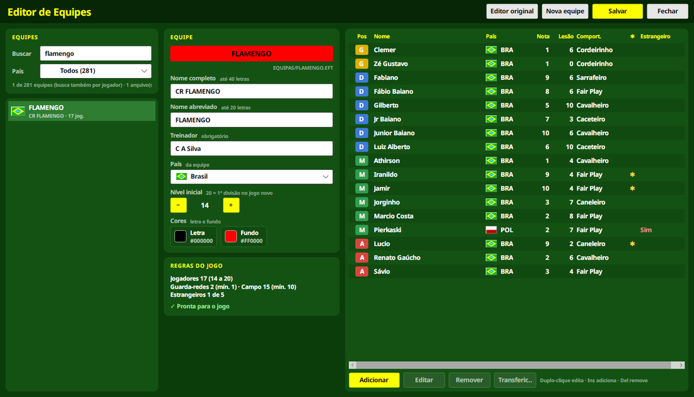 |

| Editor de Save | Launcher |
|---|---|
| 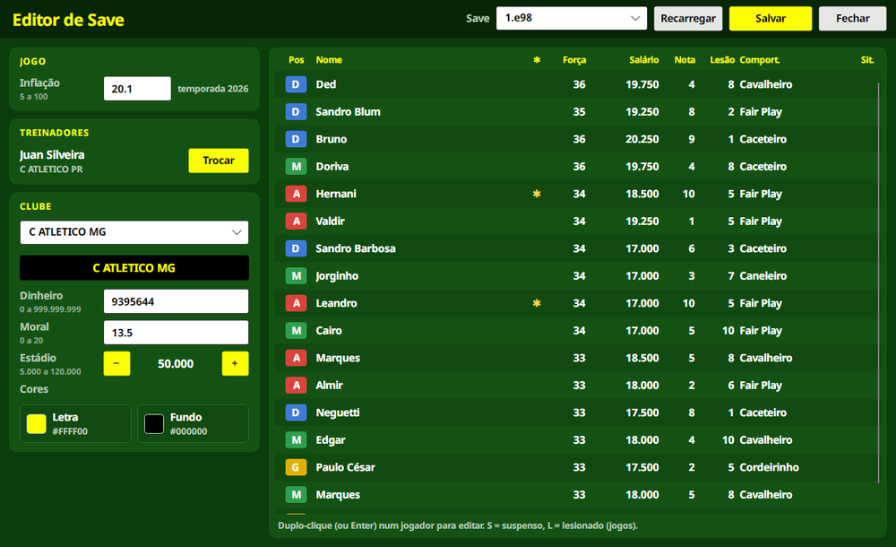 | 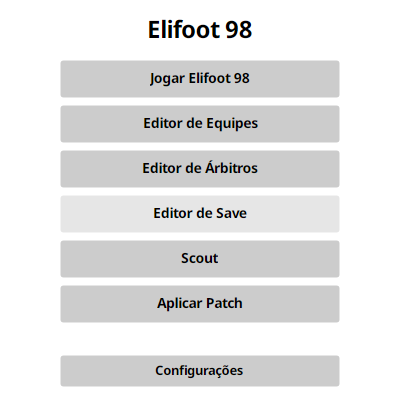 |

### Android

| Launcher | Jogo (retrato) | Táticas | Scout |
|---|---|---|---|
| 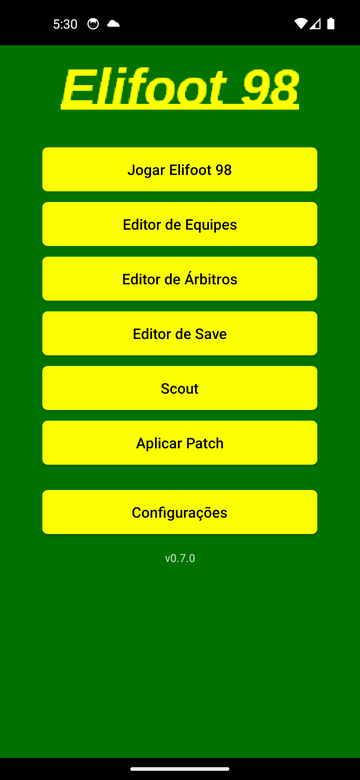 | 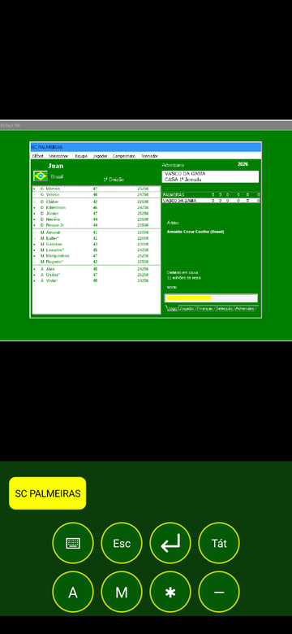 | 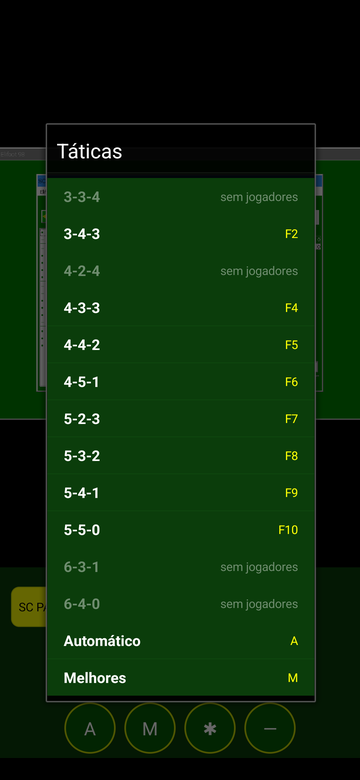 | 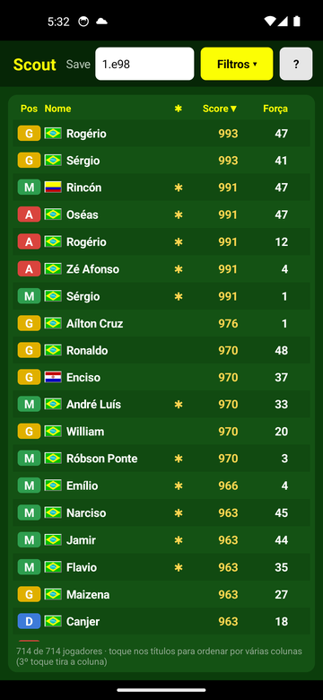 |

| Editor de Equipes | Editor de Save |
|---|---|
| 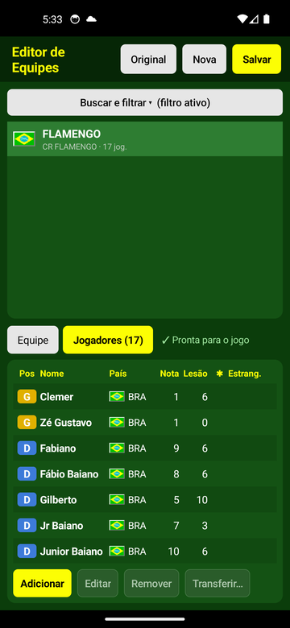 | 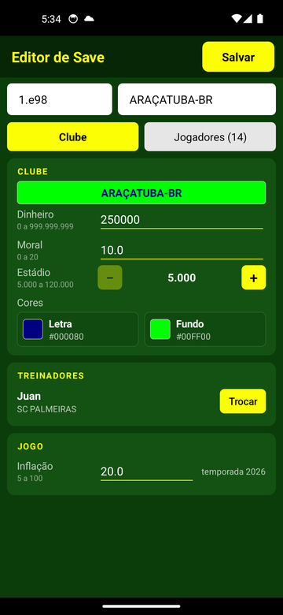 |

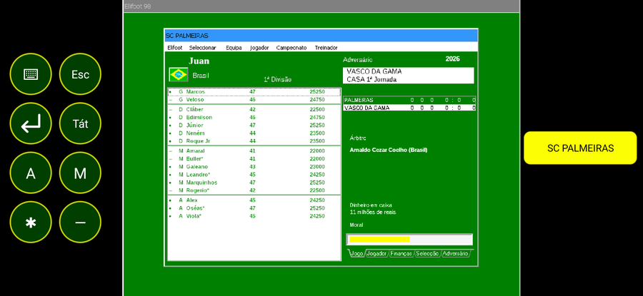

## Estado atual

Em desenvolvimento inicial. Roadmap:

- [x] Scaffold do projeto (C# WinForms + .NET Framework 4.8)
- [x] Form principal com 3 botões (Elifoot / Editor / CRACK)
- [x] Diálogo de configurações (resolução + modo janela)
- [x] Integração com otvdm (bundled) para Elifoot e Editor
- [x] Integração com DOSBox portable para CRACK
- [x] Instalador Inno Setup
- [x] Testes em VM Windows 10 e 11, Linux e Android
- [x] Editor de Equipes, Scout e Editor de Save nativos
- [x] Equipes por divisão (8 a 20) e até 30 jogadores por equipe
- [x] Cartões amarelos
- [ ] Testes em Mac

## Por que este projeto

Elifoot 98 é um app Windows 3.x (Delphi 1 + VBX 16-bit). Windows 10/11 não roda mais binários 16-bit nativamente. otvdm resolve isso, mas configurá-lo, apontar resoluções e alternar janelado/fullscreen dá trabalho a cada execução. Este launcher automatiza tudo.

## Stack

- **C# 12** + **.NET Framework 4.8** (pré-instalado em todo Win 10/11 desde 2019 — zero dependência para o usuário)
- **WinForms** para UI
- **[otvdm](https://github.com/otya128/winevdm)** (MIT) — emulação 16-bit
- **[DOSBox](https://www.dosbox.com/)** (GPL-2.0) — para o CRACK.EXE
- **[Inno Setup](https://jrsoftware.org/isinfo.php)** — instalador Windows

## Build local (Linux ou Windows)

Requer .NET SDK 8+. Em Linux Mint/Ubuntu, se o SDK apt não trouxer a workload de Windows Desktop, use o script oficial:

```bash
curl -sSL https://dot.net/v1/dotnet-install.sh | bash -s -- --channel 8.0 --install-dir ~/.dotnet
export PATH="$HOME/.dotnet:$PATH"
```

Depois:

```bash
cd src
dotnet build -c Release
# saída em src/bin/Release/net48/ElifootLauncher.exe
```

## Roadmap futuro

Além do launcher em si:

- Atualização de rosters 2025/2026 via edição dos arquivos `.EFT` (o codec já foi decodificado — implementação num tool separado)
- Tradução da UI (patch nas strings do `ELIFOOT.EXE`)
- Correções de bugs conhecidos do binário (patch)

## Licença

Este launcher é distribuído sob **GPL-3.0** (compatível com DOSBox, que é GPL-2.0-or-later).

O jogo Elifoot 98 é obra de **André Elias e Ricardo Correia**, distribuído originalmente como shareware. Este projeto tem propósito de preservação e não tem fins lucrativos.

## Créditos

- Elifoot 98 — André Elias e Ricardo Correia (1998)
- Inspiração: [elifoot98web](https://github.com/elifoot98web/elifoot98web) — versão browser
- otvdm — otya128
- DOSBox — DOSBox Team
